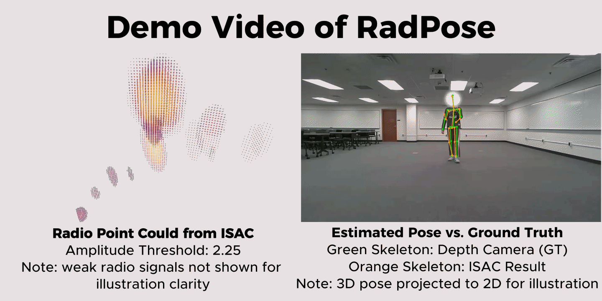

# RadPose: 3D Human Skeleton Estimation with an Integrated Sensing-and-Communication Device

<p align="center">
  <a href="https://huggingface.co/Geochou/RadPose"></a>
  <a href="https://mirrors.egr.msu.edu/inss/RadPose_dataset/download_radpose.sh"></a>
  <a href="https://arxiv.org"></a>
</p>


> Geo Jie Zhou, Kunzhe Song, Ruxin Lin, Huacheng Zeng
>
> Department of Computer Science Engineering, Michigan State University

**This work has been accepted to WACV 2027.**


## Demo



## Introduction
Human skeleton estimation under adverse lighting and occlusion conditions remains challenging for camera- and LiDAR-based systems. Although mmWave radars provide robustness to illumination and occlusion, they rely on dedicated hardware and licensed spectrum, limiting scalability.
In this paper, we present RadPose, a learning-based monostatic integrated sensing and communication (ISAC) framework that enables commodity mmWave communication devices to perform 3D human skeleton estimation. Unlike specialized radars, RadPose leverages monostatic full-duplex operation to extract channel impulse responses (CIRs) directly from standard OFDM communication signals, generating 3D radio point clouds without additional sensing hardware.
To address the sparsity and noise of RF observations, RadPose employs a cross-frame transformer-based skeleton inference network with semantic-guided spatial attention and target-driven temporal attention for robust spatio-temporal aggregation. It further adopts a joint-aware inverse kinematics refinement module based on graph convolution to enforce skeletal topology, bone-length consistency, and anatomical plausibility.
Extensive experiments demonstrate that RadPose achieves competitive accuracy compared to state-of-the-art mmWave radar-based approaches while maintaining robust performance in unseen and occluded scenarios.

## 🔧 Installation

RadPose is built with [PyTorch](https://pytorch.org/), [MMEngine](https://mmengine.readthedocs.io/en/latest/), and [MMCV](https://mmcv.readthedocs.io/en/latest/). The following commands reproduce the CUDA 11.8 environment used by this project:

```bash
conda create -n radpose python=3.8 -y
conda activate radpose
conda install pytorch==2.3.1 torchvision==0.18.1 torchaudio==2.3.1 pytorch-cuda=11.8 -c pytorch -c nvidia

git clone https://github.com/Geo-Chou/RadPose.git
cd RadPose
pip install -v -e .
```

The editable installation installs the dependencies declared in `setup.py`, including `mmcv-lite`, MMEngine, SciPy, and `spconv-cu118`. If you use a different CUDA version, install PyTorch and an SpConv build compatible with that environment instead.

## Dataset Preparation

See [this data-collection guide](https://blog.geo-zhou.com/2025/11/01/251101_mmwave_Data_Collection/) for an overview. By default, `configs/radpose.py` expects the seen and unseen datasets at:

```text
data/
├── seen/
│   └── metainfo.json
└── unseen/
    └── metainfo.json
```

Each `metainfo.json` must be a list of samples containing `split`, `source_folder`, `radar_file`, and `annotation_file`. The file paths are resolved relative to the directory containing that metainfo file. Training uses the `train` entries from `data/seen`, validation uses its `val` entries, and testing uses the `test` entries from `data/unseen`.

## 🚀 Quick Start

### Training and Evaluation

The supplied `configs/radpose.py` is configured for four GPUs, a per-GPU batch size of 26, and 12 data-loader workers per process. Adjust those values in the config for your hardware.

```bash
# Distributed training
cd RadPose
./tools/dist_train.sh configs/radpose.py 4

# Single-GPU training
python tools/train.py configs/radpose.py

# Single-GPU evaluation
python tools/test.py configs/radpose.py work_dirs/radpose/checkpoint.pth

# Distributed evaluation
./tools/dist_test.sh configs/radpose.py work_dirs/radpose/checkpoint.pth 4
```

The current model trains the heatmap estimator and inverse-kinematics refinement head together; no checkpoint-remapping step is required. Evaluation reports heatmap MPJPE, IK MPJPE, and IK PCK metrics. Visualization tooling is not included in the current repository.

## 🙏 Acknowledgement

Thanks a lot to these excellent projects:

[PyTorch](https://pytorch.org/)

[mmengine](https://github.com/open-mmlab/mmengine)

[mmcv](https://github.com/open-mmlab/mmcv)


## Citation
