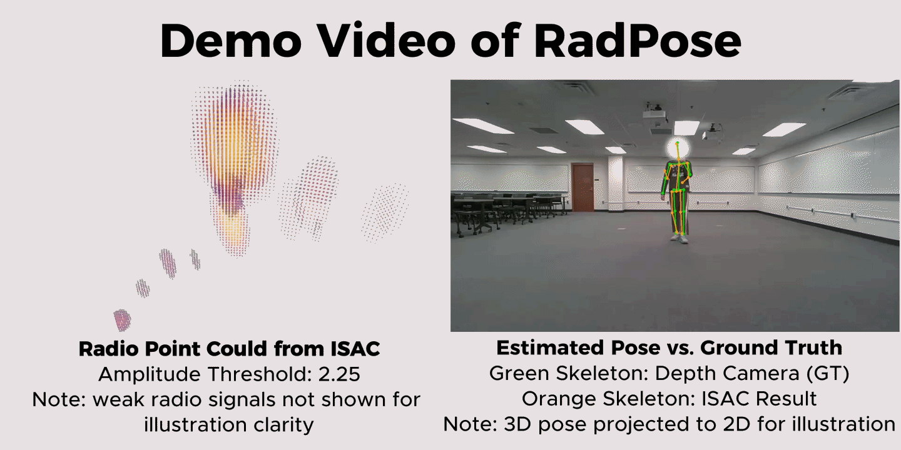

# RadPose: ISAC-based RF 3D Human Pose Estimation

<p align="center">
  <a href="https://geo-zhou.com/projects/2027-radpose/"><b>🌐 Project Page</b></a> &nbsp;|&nbsp;
  <a href="https://huggingface.co/Geochou/RadPose"><b>🤗 Checkpoints</b></a> &nbsp;|&nbsp;
  <a href="https://mirrors.egr.msu.edu/inss/RadPose_dataset/download_radpose.sh"><b>📂 Dataset</b></a> &nbsp;|&nbsp;
  <a href="https://arxiv.org/abs/2611.01400"><b>📄 Paper</b></a>
</p>


> Geo Jie Zhou, Kunzhe Song, Ruxin Lin, Huacheng Zeng
>
> Department of Computer Science Engineering, Michigan State University

**This work has been accepted to WACV 2027.**


## Demo



## Introduction
Human skeleton estimation under adverse lighting and occlusion conditions remains challenging for camera- and LiDAR-based systems. Although mmWave radars provide robustness to illumination and occlusion, they rely on dedicated hardware and licensed spectrum, limiting scalability.
In this paper, we present RadPose, a learning-based monostatic integrated sensing and communication (ISAC) framework that enables commodity mmWave communication devices to perform 3D human skeleton estimation. Unlike specialized radars, RadPose leverages monostatic full-duplex operation to extract channel impulse responses (CIRs) directly from standard OFDM communication signals, generating 3D radio point clouds without additional sensing hardware.
To address the sparsity and noise of RF observations, RadPose employs a cross-frame transformer-based skeleton inference network with semantic-guided spatial attention and target-driven temporal attention for robust spatio-temporal aggregation. It further adopts a joint-aware inverse kinematics refinement module based on graph convolution to enforce skeletal topology, bone-length consistency, and anatomical plausibility.
Extensive experiments demonstrate that RadPose achieves competitive accuracy compared to state-of-the-art mmWave radar-based approaches while maintaining robust performance in unseen and occluded scenarios.

## 🔧 Installation

RadPose is built with [PyTorch](https://pytorch.org/), [MMEngine](https://mmengine.readthedocs.io/en/latest/), and [MMCV](https://mmcv.readthedocs.io/en/latest/). The following commands reproduce the CUDA 11.8 environment used by this project:

```bash
conda create -n radpose python=3.8 -y
conda activate radpose
conda install pytorch==2.3.1 torchvision==0.18.1 torchaudio==2.3.1 pytorch-cuda=11.8 -c pytorch -c nvidia

git clone https://github.com/Geo-Chou/RadPose.git
cd RadPose
pip install -v -e .
```

The editable installation installs the dependencies declared in `setup.py`, including `mmcv-lite`, MMEngine, SciPy, and `spconv-cu118`. If you use a different CUDA version, install PyTorch and an SpConv build compatible with that environment instead.

## Dataset Preparation

See [this data-collection guide](https://blog.geo-zhou.com/2025/11/01/251101_mmwave_Data_Collection/) for an overview. The examples below assume the seen and unseen datasets are placed at:

```text
data/
├── seen/
│   └── metainfo.json
└── unseen/
    └── metainfo.json
```

Each `metainfo.json` must be a list of samples containing `split`, `source_folder`, `radar_file`, and `annotation_file`. The file paths are resolved relative to the directory containing that metainfo file. Training uses the `train` entries from `data/seen`, validation uses its `val` entries, and testing uses the `test` entries from `data/unseen`.

## 🚀 Quick Start

### Writing a Config

Before start, prepare your own MMEngine config (for example `configs/my_radpose.py`) following the template below: replace every `...` with a value of the type given in its comment. Keys not listed keep the defaults in the corresponding class's `__init__` under `mmwave3d/`.

```python
default_scope = "mmwave3d"
custom_imports = dict(imports=["mmwave3d"], allow_failed_imports=False)
work_dir = ...                       # str: output directory

num_frames = ...                     # int (odd): radio frames per sample, centred on the labelled frame
point_cloud_range = [...]            # 6 floats: r_min, az_min, el_min, r_max, az_max, el_max (metres, radians)

model = dict(
    type="MmKeypoints",
    data_preprocessor=dict(
        type="SparseVoxelization",
        point_cloud_range=point_cloud_range,
        angles_in_degrees=False,     # radio files store angles in radians
        voxel_size_r=...,            # float: range voxel size (m)
        voxel_angle_size_deg=...,    # float: angular voxel size, in radians when angles_in_degrees=False
        expected_frames=num_frames,
        data_norm=...,               # bool: normalise coordinates to [0, 1]
        max_tokens_per_sample=...,   # int or None: cap on voxel tokens per sample
    ),
    transformer=dict(
        type="PhysicsAwareFPNFrameQueryTransformer",
        embed_dim=...,               # int: feature width, equal to both heads' in_dim
        num_layers=...,              # int
        num_heads=...,               # int: divides embed_dim
        ffn_dim=...,                 # int
        num_query_tokens=...,        # int: a perfect square (e.g. 16 * 16)
    ),
    head=dict(
        type="HeatmapIKHead",
        heatmap_head=dict(
            type="CNNHeatmapHead",
            in_dim=...,              # int: equal to embed_dim
            num_person=1,
            num_joints=16,
            num_frames=num_frames,
            use_matching=False,
            point_cloud_range=point_cloud_range,
            range_bins=...,          # int: heatmap bins along range
            angle_bins=...,          # int: heatmap bins along azimuth
            sigma_r=...,             # float: target Gaussian width in range (m)
            sigma_a=...,             # float: target Gaussian width in angle (rad)
            loss_heatmap=dict(type="Heatmap2DLoss", loss_weight=...),    # float
            loss_elevation=dict(type="ElevationLoss", loss_weight=...),  # float
        ),
        ik_head=dict(
            type="IKHead",
            in_dim=...,              # int: equal to embed_dim
            num_person=1,
            num_joints=16,
            root_index=6,            # pelvis
            skeleton_edges=[...],    # list of (child, parent) int pairs: the MPII tree rooted at joint 6
            bone_length_means=[...], # list of (child, parent, float): mean bone length (m) from training labels
            point_cloud_range=point_cloud_range,
            loss_ik_coord=dict(type="MPJPELoss", loss_weight=...),       # float
        ),
    ),
)

load_points = dict(
    type="LoadMmPointsFromFile",
    load_dim=5, use_dim=[0, 1, 2, 3, 4],   # range, azimuth, elevation, amplitude, phase
    use_amplitude=True, use_phase=True,
    normalize_amplitude=...,         # bool: min-max normalise amplitude per frame
    normalize_phase=...,             # bool
)
filter_points = dict(
    type="TemporalPhaseFiltering",
    amp_threshold=...,               # float: drop weaker points; in [0, 1] if amplitude is normalised
    use_phase=...,                   # bool: also keep points whose phase changes between frames
)
train_pipeline = [
    load_points,
    filter_points,
    dict(type="UniformSampling", sampling_ratio=...),   # optional; float in (0, 1]
    dict(type="LoadAnnotations3D", with_keypoints_3d=True, eval=False),
    dict(type="Pack3DInputs", keys=("points", "gt_keypoints_3d")),
]
test_pipeline = [
    load_points,
    filter_points,
    dict(type="LoadAnnotations3D", with_keypoints_3d=True, eval=True),
    dict(type="Pack3DInputs", keys=("points", "gt_keypoints_3d")),
]

train_dataloader = dict(
    batch_size=...,                  # int: per GPU
    num_workers=...,                 # int
    sampler=dict(type="DefaultSampler", shuffle=True),
    dataset=dict(
        type="MMWaveDataset",
        data_root="data/seen/",      # str: folder holding metainfo.json
        metainfo_file="metainfo.json",
        num_frames=num_frames,
        frame_interval=...,          # int: frames skipped between window frames (0 = consecutive)
        pipeline=train_pipeline,     # reads the "train" entries
    ),
)
val_dataloader = dict(
    batch_size=..., num_workers=...,
    sampler=dict(type="DefaultSampler", shuffle=False),
    dataset=dict(type="MMWaveDataset", data_root="data/seen/", metainfo_file="metainfo.json",
                 num_frames=num_frames, frame_interval=..., test_mode=True,
                 pipeline=test_pipeline),            # reads the "val" entries
)
test_dataloader = dict(
    batch_size=..., num_workers=...,
    sampler=dict(type="DefaultSampler", shuffle=False),
    dataset=dict(type="MMWaveDataset", data_root="data/unseen/", metainfo_file="metainfo.json",
                 num_frames=num_frames, frame_interval=..., test_mode=True, split="test",
                 pipeline=test_pipeline),
)

val_evaluator = [
    dict(type="HeatmapMPJPE", point_cloud_range=point_cloud_range),
    dict(type="IKMPJPE", point_cloud_range=point_cloud_range),
    dict(type="IKPCKMetric", thresholds=(...,)),     # tuple of floats: PCK thresholds (m)
]
test_evaluator = val_evaluator

# Standard MMEngine training settings
train_cfg = dict(type="EpochBasedTrainLoop", max_epochs=..., val_interval=...)  # ints
val_cfg = dict(type="ValLoop")
test_cfg = dict(type="TestLoop")
optim_wrapper = dict(type="OptimWrapper",
                     optimizer=dict(type="AdamW", lr=..., weight_decay=...))     # floats
param_scheduler = [...]              # list of MMEngine scheduler dicts
default_hooks = dict(checkpoint=dict(type="CheckpointHook", interval=1,
                                     save_best="ik/MPJPE", rule="less"))
```

Values that must agree:

- `num_frames` is shared by the datasets, `expected_frames`, and the heatmap head.
- `point_cloud_range` is shared by the voxelizer, both heads, and both MPJPE metrics, and should lie inside the radio grid: range 0.48–7.56 m, azimuth 31°–150°, elevation −29°–30°, given in radians.
- Both heads' `in_dim` equal the transformer's `embed_dim`; the IK head's `in_dim` must also be divisible by `joint_attn_num_heads` (default 8).
- `num_person=1` and `num_joints=16` must be set explicitly; some class defaults differ.
- `bone_length_means` must not be empty: bones without a length collapse onto the root joint.

### Training and Evaluation

```bash
# Distributed training
cd RadPose
./tools/dist_train.sh configs/my_radpose.py 4

# Single-GPU training
python tools/train.py configs/my_radpose.py

# Single-GPU evaluation
python tools/test.py configs/my_radpose.py work_dirs/my_radpose/checkpoint.pth

# Distributed evaluation
./tools/dist_test.sh configs/my_radpose.py work_dirs/my_radpose/checkpoint.pth 4
```

The current model trains the heatmap estimator and inverse-kinematics refinement head together; no checkpoint-remapping step is required. Evaluation reports heatmap MPJPE, IK MPJPE, and IK PCK metrics. Visualization tooling is not included in the current repository.

## 🙏 Acknowledgement

Thanks a lot to these excellent projects:

[PyTorch](https://pytorch.org/)

[mmengine](https://github.com/open-mmlab/mmengine)

[mmcv](https://github.com/open-mmlab/mmcv)


## Citation
```
@inproceedings{hor2023mvdoppler,
  title={RadPose: ISAC-based RF 3D Human Pose Estimation},
  author={Zhou, Geo Jie and Song, Kunzhe and Lin, Ruxin and Zeng, Huacheng},
  booktitle={The IEEE/CVF Winter Conference on Applications of Computer Vision (WACV)},
  year={2027}
}
```